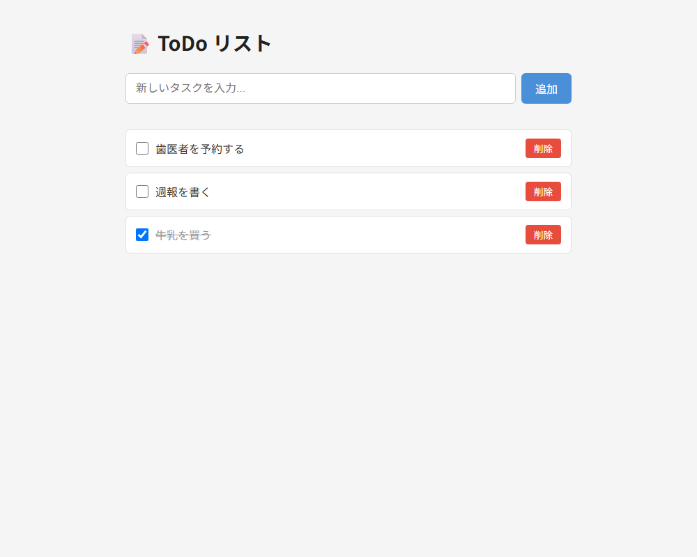

# Auto Coding Ecosystem (ACE)

[🇯🇵 日本語](README.md) | [🇺🇸 English](README.en.md)

Auto Coding Ecosystem, abbreviated **ACE** and pronounced "ace", is a locally-executed automated coding pipeline that uses Claude / Codex / GitHub CLI to assist with requirements definition, design, task decomposition, implementation, review, fixing, PR creation, and merging.

> First-time users: see the illustrated [HTML guide](https://noppi401.github.io/auto-coding-ecosystem/guide.html) for a visual walkthrough.

**Test run**: from a single request, ACE built a working ToDo web app in an empty repository, with no manual code changes.

- 8 tasks became 8 PRs, and all were merged
- All 200 tests pass
- About 1 h 28 min, $8.24 (Claude CLI estimate)

See the [test run report](docs/test-runs/2026-11-todo-app.en.md) for details.



**Language:** the UI and everything ACE writes (PR comments, validation reports, Issues) are in Japanese by default. Set `ACE_LANG=en` in `.env` to switch them to English. The screenshots below show English mode.

## Screenshots

### Home Menu (`npm run dev`)

```text
 ▲  Auto Coding Ecosystem

 ◆  What would you like to do?
 │  ● New request              Create a new request
 │  ○ Run from Issue           Run from open Issues in an existing repository
 │  ○ Resume Phase 2  (myorg/my-app)  Resume an in-progress coding loop
 │  ○ Phase 1 only             Plan only (create Issues and stop)
 │  ○ Show status              Show current project status
 │  ○ Quit
 └
```

### Request Wizard (New request)

```text
 ◆  Project type
 │  ● Create a new repository    Create and implement in a new repository
 │  ○ Modify an existing repository    Add features or fix an existing repository
 └

 ◆  New repository name
 │  my-new-app
 └

 ◆  How to enter your request
 │  ● Single line input          For short instructions
 │  ○ Multi-line editor input    Open $EDITOR / notepad with multi-line support
 │  ○ Load from file             .md / .txt / .html (PDF not supported)
 └

 ◆  Which phase(s) would you like to run?
 │  ● Phase 1 + 2  (plan → implement automatically)  Recommended
 │  ○ Phase 1 only  (plan only, create Issues)
 │  ○ Phase 2 only  (resume from existing plan)
 └

 ◆  AI provider (primary)
 │  ● Claude   Anthropic Claude CLI
 │  ○ Codex    OpenAI Codex CLI
 │  ○ Gemini   Google Gemini CLI
 └

 ◇  Ready · myorg/my-new-app · phase1+2 · claude→codex
```

### Run Screen (Phase 2 Coding Loop)

```text
▲ Auto Coding Ecosystem · myorg/my-app · Phase 2 · Coding Loop · ⣷ Running · 00:03:42
────────────────────────────────────────────────────────────────────────────────────────
 #1 ✓ Project setup                    │ Task 4/6 · Issue #7 · Implement the list command
 #2 ✓ Implement the persistence layer  │ ────────────────────────────────────────────
 #3 ✓ Implement the add command        │ [info]  CodingAgent: generating code...
 #4 ⣷ Implement the list command       │ [info]  Running tsc --noEmit...
 #5 ○ Implement complete/delete        │ [info]  Running npm test...
 #6 ○ E2E tests and documentation      │ [info]  ReviewAgent: checking diff...
                                       │ [info]  No blocking issues found.
                                       │ [info]  GitHubAgent: merging PR #8...
────────────────────────────────────────────────────────────────────────────────────────
  ↑↓ Select task  ↵ Details  l Logs  p Pause  o Open PR  q Quit
```

### Task Approval Preview (before creating Issues)

```text
▲ Auto Coding Ecosystem · myorg/my-app · Phase 1 · Task Decomp · ⏸ Waiting for input · 00:01:12
────────────────────────────────────────────────────────────────────────────────────────
 ▶ Task breakdown (6) · review before creating Issues
   1. Project setup [low]
   2. Implement the persistence layer [medium]
   3. Implement the add command [low]
   4. Implement the list command [low]
   5. Implement complete/delete [medium]
   6. E2E tests and documentation [medium]
   Enter to approve and create Issues · c to cancel
────────────────────────────────────────────────────────────────────────────────────────
```

### Session Complete Screen (SummaryScreen)

```text
▲ Session complete · myorg/my-app · duration 00:18:45
────────────────────────────────────────────────────────────────────────────────────────
    6 merged      0 failed      0 skipped      0 pending
  ██████████████████████████████████████████  100%

──────────────────────────────────────────────────────────────────────────────────────
 #  TASK                               STATUS        PR     ISSUE   ITER  CHECK
 1  Project setup                      ✓ merged      #2     #1      -     -
 2  Implement the persistence layer    ✓ merged      #4     #3      -     -
 3  Implement the add command          ✓ merged      #6     #5      -     -
 4  Implement the list command         ✓ merged      #8     #7      2/5   -
 5  Implement complete/delete          ✓ merged      #10    #9      -     -
 6  E2E tests and documentation        ✓ merged      #12    #11     -     -
──────────────────────────────────────────────────────────────────────────────────────
  REPOSITORY  https://github.com/myorg/my-app
  ↑↓ Select  ↵ Run  l Logs  q Quit
```

### Status Check (`npm run dev -- status`)

```text
Project   : myorg/my-app
Repo      : https://github.com/myorg/my-app
Phase     : coding_loop
Instruction: Build a task management CLI in Node.js. Support adding, listing, completing...
Progress  : [████████░░░░░░░░░░░░░░░░] 33%  (2/6)
Summary   : merged 2  in-progress 1  pending 3  skipped 0  failed 0

#   TASK                                 STATUS       ISSUE   PR     AGE     DETAIL
---------------------------------------------------------------------------------------------
1   Project setup                        merged       #1      #2     45m00s  -
2   Implement the persistence layer      merged       #3      #4     32m18s  -
3   Implement the add command            in-progress  #5      #6     03m41s  -
4   Implement the list command           pending      #7      -      0s      -
5   Implement complete/delete            pending      #9      -      0s      -
6   E2E tests and documentation          pending      #11     -      0s      -

Links:
  1. Project setup  issue https://github.com/myorg/my-app/issues/1  pr https://github.com/myorg/my-app/pull/2
  ...
```

## How It Works (Pipeline and Agent Architecture)

The Orchestrator calls each agent in sequence; state is saved to `.ecosystem/state.json` (via `StateManager`). Each agent extends `BaseAgent`, which handles LLM provider calls, fallback logic, and usage-limit detection in a shared implementation.

### Phase 1: Planning (Requirements → Design → Task Decomposition → Issue Creation)

1. **RequirementsAgent** generates a requirements document from the instruction (and existing repository context). If the instruction is at least `REQ_SPLIT_CHARS` (default 8000) characters, it is split into categories by its Markdown headings (or by LLM-proposed line ranges when there are none), requirements are written per category, and a "cross-category requirements and conflicts" section is appended.
2. **RequirementsValidationAgent** scores the requirements; if below the threshold, a correction loop runs (`.ecosystem/requirements-validation.md`).
3. **DesignAgent** generates a design document from the requirements.
4. **DesignValidationAgent** scores the design; if below the threshold, a correction loop runs (`.ecosystem/design-validation.md`).
5. **TaskDecompAgent** decomposes the full requirements and design docs into implementable tasks (each task is assigned a `complexity` rating and its own small test file in `testFiles`). If the task that creates `package.json` touches only config files, it is moved to the front.
6. An **acceptance task** (acceptance tests and smoke check) is automatically appended after the decomposed tasks (disable with `ACCEPTANCE_TASK_ENABLED=false`).
7. After task-list approval (`TASK_APPROVAL`), **GitHubAgent** creates a GitHub Issue for each task.

When modifying an existing repository, **RepoContextSummaryAgent** summarizes the repository context once and reuses it in steps 1, 3, and 5 to reduce token usage (`REPO_CONTEXT_SUMMARY`).

Claude is called through `claude -p` with tools disabled, and its result is taken only as JSON text (so the model cannot write directly into the working folder or operate external services). If it does not respond after starting, this is detected and the call is retried (`CLAUDE_STARTUP_TIMEOUT_MS` / `CLAUDE_STARTUP_RETRIES`).

### Phase 2: Implementation (Per-task Coding Loop)

Tasks are processed one at a time, always maintaining "one active Issue/PR at a time."

1. **GitHubAgent** creates a branch.
2. **CodingAgent** generates code and test files (automatically selects the implementation model based on task complexity: `TASK_MODEL_ROUTING`). It sees the config files (`package.json` / `tsconfig.json`), the file list, the plan for the other tasks, and the current full content of its target files, then outputs new files as arrays of lines and changes to existing files as diffs (hunks). If no test files are produced, it automatically retries to ensure tests are generated.
   - For the acceptance task, **AcceptanceTestAgent** writes HTTP-level acceptance tests from the requirements alone, without seeing the implementation (the tests start the real app).
3. **GitHubAgent** commits and creates a PR, then comments the PR link on the Issue.
4. Review loop:
   - The deterministic gate runs in a worktree, after every implementation and every fix:
     - Type check (`tsc --noEmit`, when `tsconfig.json` exists) and JS syntax check (`node --check`)
     - Dependency install and `npm test`. Without `package.json` or a test script, test files are run directly with `node --test`
     - Detection of a test script that runs only some of the test files
     - Acceptance task only: a smoke check (start with `npm start` on a given PORT and expect `GET /` to return 2xx/3xx) and detection of source files that the entry file never loads
     - On test failure, the structured failure details (file, test name, error) are passed to **FixAgent**
   - The PR diff is scanned for deleted test files, added `.skip`, and a net decrease in test cases or assertions; any such change is blocked as a deterministic guard against **FixAgent** removing tests.
   - **ReviewAgent** (optionally + **CodexAgent** for independent review: `CODEX_REVIEW_ENABLED`) evaluates the PR diff. It also gets the full content of changed files, the config files, and the repository files that the changed files import, so it can check that calls match what they call.
   - If there are blocking findings, **FixAgent** makes a fix commit → re-review (up to `MAX_REVIEW_ITERATIONS` times). If FixAgent tries to overwrite an existing file it was not shown, a guard blocks it and calls it once more with that file shown.
5. Once approved, **GitHubAgent** merges → closes the Issue → syncs the verification worktree.

A record of an actual run that generated a ToDo app (run time, cost, screenshot) is in [`docs/test-runs/2026-11-todo-app.en.md`](docs/test-runs/2026-11-todo-app.en.md).

PR diffs for review are capped and trimmed at `PR_DIFF_MAX_CHARS`; requirements/design docs passed to code generation can be filtered to task-relevant sections via `IMPL_DOC_RELEVANCE` (both reduce token usage).

When a usage limit is reached, the system automatically switches to `FALLBACK_LLM_PROVIDER`, or you can resume with `--retry-failed`.

### State and UI

- State is saved incrementally to `.ecosystem/state.json`; the `Orchestrator` and Ink UI communicate through an event bus (`src/events.ts`).
- The interactive UI header always shows the current run state (⏸ waiting for input / ● running / ✓ done), so you can always see which Issue/task is being processed even while viewing logs.

## Prerequisites

- Node.js 20+
- Claude CLI (`claude` command available)
- GitHub CLI (`gh auth login` completed)
- Codex CLI (used as fallback when Claude hits its usage limit)
- GitHub access token

## Setup

```bash
npm install
cp .env.example .env
```

Set at minimum the following in `.env`:

```env
GITHUB_TOKEN=ghp_xxx
GITHUB_OWNER=your-github-owner
```

## Starting

Launch in interactive mode:

```bash
npm run dev
```

To open in a separate Windows Terminal window:

```powershell
npm run dev:window
```

## Using as a Global Command (`ace`)

Build and `npm link` to launch `ace` from any directory.

```bash
npm run build
npm link
```

```bash
ace                       # interactive mode (home menu)
ace status                # check status
ace phase2 --retry-failed # retry failed tasks
ace start --instruction-file ./instruction.txt --repo-name my-repo --auto
```

`ace <command>` accepts the same arguments as `npm run dev -- <command>`. To unlink: `npm unlink -g auto-coding-ecosystem`.

> Note: `ace` reads `.ecosystem/state.json` in the directory where it is run. Use a separate working directory for each project.

## Basic Commands

### Create a New Repository

```bash
npm run dev -- start --instruction-file ./instruction.txt --repo-name my-repo
```

To run Phase 1 through Phase 2 automatically:

```bash
npm run dev -- start --instruction-file ./instruction.txt --repo-name my-repo --auto
```

### Modify an Existing Repository

```bash
npm run dev -- modify --target-repo owner/repo --instruction-file ./change-request.txt --auto
```

For repositories under `GITHUB_OWNER`, you can specify just the repo name:

```bash
npm run dev -- modify --target-repo existing-app --instruction-file ./change-request.txt --auto
```

In interactive mode's `Run from Issue`, you can multi-select or select all open Issues to run. When an existing Issue is selected, it is treated as an execution task directly (no additional task-decomposition Issues are created). To specify Issues from the CLI:

```bash
npm run dev -- modify --target-repo owner/repo --issue-number 123 --auto
npm run dev -- modify --target-repo owner/repo --issue-number 123,124 --auto
```

### Run Phase 2 Only

```bash
npm run dev -- phase2
```

To retry failed tasks:

```bash
npm run dev -- phase2 --retry-failed
```

To retry failed tasks until the usage limit is reached:

```bash
npm run dev -- phase2 --retry-failed --loop-until-limit --limit-provider all
```

### Check Status

```bash
npm run dev -- status
```

State is saved to `.ecosystem/state.json`.

## Interactive Mode Features

- **Multi-line instruction input**: Select "Multi-line editor input" for a new request to open `$EDITOR` (Windows: notepad / others: vi) for multi-line instructions.
- **Load request from file**: Select "Load from file" to read a `.md` / `.txt` / `.html` requirements file. HTML is converted to plain text (tags, scripts and styles removed). PDF is not supported (loading one fails with an error).
- **Save and restore selections**: Provider, model, phase, etc. are saved to `.ecosystem/wizard-defaults.json` and restored as defaults on next launch (`.env` / CLI args take priority).
- **Execution count selection**: When running `Phase 1 + 2`, choose from "once / multiple / until limit" (available for both new requests and Issue runs).
- **Task approval**: Preview the task list before creating GitHub Issues; approve (Enter) or cancel (c) (`TASK_APPROVAL=false` to disable; always skipped with `--auto`).
- **Auto model selection**: When using Claude, after selecting the implementation model you can choose "Fixed" or "Auto". With "Auto", the model is automatically selected by task complexity (low→haiku / medium→sonnet / high→opus), with your selected model as the ceiling.
- **Run state visualization**: The header always shows ⏸ waiting / ● running / ✓ done. The current Issue is visible even while viewing logs.

## Writing Instruction Files

For long instructions, passing them via `--instruction-file` is recommended to avoid encoding issues or shell escaping problems. `.md` / `.txt` / `.html` files are supported (HTML is converted to text; PDF is not supported).

PowerShell:

```powershell
@'
Build a task management CLI in Node.js. Support adding, listing, completing, and deleting tasks; persist data in a JSON file.
'@ | Out-File -Encoding utf8 instruction.txt

npm run dev -- start --instruction-file ./instruction.txt --repo-name task-cli-test --auto
```

bash / WSL:

```bash
cat > instruction.txt <<'EOF'
Build a task management CLI in Node.js. Support adding, listing, completing, and deleting tasks; persist data in a JSON file.
EOF

npm run dev -- start --instruction-file ./instruction.txt --repo-name task-cli-test --auto
```

## Model Selection

Specify models via CLI arguments (CLI args override `.env`):

```bash
npm run dev -- start --instruction-file ./instruction.txt --repo-name my-repo --claude-model claude-opus-4-7
```

```bash
npm run dev -- phase2 --planning-model claude-haiku-4-5-20251001
```

```bash
npm run dev -- phase2 --impl-model claude-sonnet-4-6
```

For Codex, specify model and intelligence together:

```bash
npm run dev -- start --instruction-file ./instruction.txt --repo-name my-repo --provider codex --codex-model gpt-5.5 --codex-intelligence high
```

| Option | Env Variable | Description |
| --- | --- | --- |
| `--provider <claude\|codex\|gemini>` | `PLANNING_LLM_PROVIDER` / `IMPLEMENTATION_LLM_PROVIDER` | Set both planning and implementation provider at once |
| `--fallback-provider <claude\|codex\|gemini>` | `FALLBACK_LLM_PROVIDER` | Provider to use when the primary hits its limit |
| `--claude-model <id>` | `PLANNING_CLAUDE_MODEL` / `IMPLEMENTATION_CLAUDE_MODEL` | Set both planning and implementation model at once |
| `--planning-model <id>` | `PLANNING_CLAUDE_MODEL` | Model for requirements, design, task decomposition |
| `--impl-model <id>` | `IMPLEMENTATION_CLAUDE_MODEL` | Model for CodingAgent / FixAgent |
| `--codex-model <id>` | `CODEX_MODEL` | Model passed to Codex CLI |
| `--gemini-model <id>` | `PLANNING_GEMINI_MODEL` / `IMPLEMENTATION_GEMINI_MODEL` | Gemini model (sets both planning and implementation) |
| `--codex-intelligence <low\|medium\|high\|xhigh>` | `CODEX_INTELLIGENCE` | Codex CLI `model_reasoning_effort` |

### Automatic Model Selection by Task Complexity (Token Reduction)

With `TASK_MODEL_ROUTING=true` or by selecting "Auto" in the interactive wizard, TaskDecompAgent assigns a complexity (low / medium / high) to each task, and the implementation model is automatically selected accordingly (default: low→haiku, medium→sonnet, high→opus). Routing simpler tasks to cheaper models reduces token usage and cost.

If the user explicitly specifies an implementation model via `--impl-model` or the Wizard, that selection is treated as a "ceiling" — routing will never exceed it (e.g., if sonnet is selected, high tasks also use sonnet while low tasks still use haiku). Override per-rank models with `TASK_MODEL_LOW` / `TASK_MODEL_MEDIUM` / `TASK_MODEL_HIGH`.

## Key Environment Variables

| Variable | Default | Description |
| --- | --- | --- |
| `GITHUB_TOKEN` | — | GitHub API / CLI token |
| `GITHUB_OWNER` | — | Default GitHub owner |
| `BASE_BRANCH` | `main` | Base branch for PRs |
| `MAX_REVIEW_ITERATIONS` | `5` | Maximum review-and-fix iterations |
| `TASK_APPROVAL` | `true` | Preview and approve task list before creating Issues (always skipped with `--auto`) |
| `ACCEPTANCE_TASK_ENABLED` | `true` | Automatically append the acceptance task (acceptance tests and smoke check) after decomposition. `false` to disable |
| `PLANNING_LLM_PROVIDER` | `claude` | LLM provider for Phase 1 |
| `IMPLEMENTATION_LLM_PROVIDER` | `claude` | LLM provider for implementation and fixing |
| `CLAUDE_MODEL` | `claude-haiku-4-5-20251001` | Common Claude model |
| `IMPLEMENTATION_CLAUDE_MODEL` | `claude-sonnet-4-6` | Model for CodingAgent / FixAgent |
| `TASK_MODEL_ROUTING` | `false` | Auto-select implementation model by task complexity. Enable with `true` (also configurable in the interactive wizard) |
| `TASK_MODEL_LOW` | `claude-haiku-4-5-20251001` | Implementation model for complexity=low tasks |
| `TASK_MODEL_MEDIUM` | `claude-sonnet-4-6` | Implementation model for complexity=medium tasks |
| `TASK_MODEL_HIGH` | `claude-opus-4-7` | Implementation model for complexity=high tasks |
| `IMPL_DOC_RELEVANCE` | `false` | Filter requirements/design docs to task-relevant sections during code generation. Enable with `true` |
| `IMPL_DOC_MAX_CHARS` | `6000` | Max characters of requirements doc passed to CodingAgent when filtering |
| `IMPL_DESIGN_DOC_MAX_CHARS` | `4000` | Max characters of design doc passed to CodingAgent when filtering |
| `PR_DIFF_MAX_CHARS` | `30000` | Max characters of PR diff for review/fix. Trimmed when exceeded. `0` to disable |
| `PR_DIFF_EXCLUDE` | `package-lock.json,pnpm-lock.yaml,yarn.lock` | Files to exclude from PR diff (comma-separated) |
| `GEMINI_API_KEY` | — | Gemini API key |
| `GEMINI_MODEL` | `gemini-2.5-flash` | Common Gemini model (default for both planning and implementation) |
| `PLANNING_GEMINI_MODEL` | `GEMINI_MODEL` | Gemini model for planning |
| `IMPLEMENTATION_GEMINI_MODEL` | `GEMINI_MODEL` | Gemini model for implementation |
| `BUILD_CHECK_ENABLED` | `true` | Enable build / type-check / test after PR creation |
| `COVERAGE_CHECK_ENABLED` | `false` | Enable coverage measurement (`true` to enable). Requires a `test:coverage` script in `package.json` |
| `COVERAGE_LINE_THRESHOLD` | `70` | Line coverage threshold (%). Below this adds a suggestion comment |
| `COVERAGE_BRANCH_THRESHOLD` | `60` | Branch coverage threshold (%). Below this adds a suggestion comment |
| `COVERAGE_CHECK_STRICT` | `false` | When `true`, missing, unparsed, or failed coverage checks are treated as blocking |
| `CODEX_REVIEW_ENABLED` | `false` | Enable independent Codex review |
| `CODEX_MODEL` | Codex CLI default | Model passed to Codex CLI |
| `CODEX_INTELLIGENCE` | Codex CLI default | Codex CLI `model_reasoning_effort` (`low` / `medium` / `high` / `xhigh`) |
| `CODEX_TIMEOUT_MS` | `AGENT_COMMAND_TIMEOUT_MS` | CodexAgent-specific timeout. Falls back to `AGENT_COMMAND_TIMEOUT_MS`, then `900000` |
| `RESUME_AGENT_SESSIONS` | `false` | Use Claude session continuation |
| `AGENT_COMMAND_TIMEOUT_MS` | `900000` | BaseAgent command timeout (ms). CodexAgent uses it when `CODEX_TIMEOUT_MS` is unset |
| `CLAUDE_STARTUP_TIMEOUT_MS` | `120000` | How long to wait for the Claude CLI's first output after starting. The call is retried when exceeded |
| `CLAUDE_STARTUP_RETRIES` | `2` | How many times to retry when Claude does not respond after starting |
| `CODING_CURRENT_FILE_MAX_CHARS` | `60000` | Max characters per existing file passed to CodingAgent |
| `FIX_CURRENT_FILE_MAX_CHARS` | `60000` | Max characters per existing file passed to FixAgent |
| `REPO_CONTEXT_SUMMARY` | `false` | On modify, summarize repository context once and reuse across requirements/design/task decomposition to reduce tokens. Enable with `true` |
| `REPO_CONTEXT_SUMMARY_INPUT_MAX_CHARS` | `40000` | Max characters of context passed to the summary agent |
| `REQ_SPLIT_MODE` | `auto` | Per-category requirements generation. `auto` (by size) / `always` / `never` |
| `REQ_SPLIT_CHARS` | `8000` | In `auto` mode, split into categories when the instruction is at least this many characters |
| `TASK_DECOMP_REQ_DOC_MAX_CHARS` | none (full text) | Max characters of the requirements doc passed to task decomposition. When set, the excess is truncated with a warning |
| `TASK_DECOMP_DESIGN_DOC_MAX_CHARS` | none (full text) | Max characters of the design doc passed to task decomposition. When set, the excess is truncated with a warning |
| `REPO_CONTEXT_MAX_FILES` | `80` | Max files read when scanning an existing repo |
| `REPO_CONTEXT_MAX_CHARS` | `40000` | Max characters read when scanning an existing repo |
| `REPO_CONTEXT_FILE_MAX_CHARS` | `4000` | Max characters per file when scanning |
| `ISSUE_SELECT_LIMIT` | `30` | Max open Issues shown in the interactive list |
| `ISSUE_RUN_ALL_LIMIT` | `1000` | Max Issues fetched when selecting "all open Issues" |
| `PHASE2_LOOP_MAX_ATTEMPTS` | `100` | Max attempts for `--loop-until-limit` |
| `LOG_LEVEL` | `info` | Log level |
| `ACE_LANG` | `ja` (`en` if `LANG` starts with `en`) | Language of the UI and of everything ACE writes (PR comments, validation reports, Issues). `en` for English |

## Development Commands

```bash
npm run build
npx tsc --noEmit
npm test
npm run dev -- status
```

If PowerShell blocks `npm` / `npx` due to execution policy, use the `.cmd` variants:

```powershell
npm.cmd run build
npx.cmd tsc --noEmit
```

## Checking Generated Apps

Worktrees created by the ecosystem are under `.ecosystem/worktrees/<owner>/<repo>/...`. The main working tree used as a reference:

```powershell
cd .ecosystem\worktrees\<owner>\<repo>\__context
```

In Phase 2, this `__context` worktree is synced to `origin/<BASE_BRANCH>` immediately after each PR merge and again just before Phase 2 completes. If sync fails, Phase 2 is marked as failed rather than completed.

If `__context` has uncommitted changes, automatic sync is paused for safety. The error includes the target path, `git status --porcelain` file list, and recovery steps. Stash or commit your changes before retrying.

Additionally, if `~/Documents/Products/<repo>` exists, it is also synced as a verification checkout. For example:

```powershell
C:\path\to\Products\<repo>
```

To specify the verification checkout path explicitly:

```env
ECOSYSTEM_PRODUCT_WORKTREE=C:\path\to\Products\<repo>
```

To change just the `Products` root across multiple repos:

```env
ECOSYSTEM_PRODUCT_ROOT=C:\path\to\Products
```

If the Products directory has uncommitted changes, sync is also paused for safety. The error includes whether the target came from `ECOSYSTEM_PRODUCT_WORKTREE` or the Products checkout, plus the dirty file list.

The following is an example verification procedure for a generated app with a backend / frontend structure (using Prisma). Adapt as needed for your generated app's structure.

Install dependencies:

```powershell
cd backend
npm.cmd ci
npx.cmd prisma generate
cd ..\frontend
npm.cmd ci
```

Verify build:

```powershell
cd ..\backend
npm.cmd run build
cd ..\frontend
npm.cmd run build
```

Apply DB migrations:

```powershell
cd ..\backend
npx.cmd prisma migrate deploy
```

If `DATABASE_URL` is not set, `prisma migrate deploy` will fail. Set `DATABASE_URL` in the generated app's `.env`, or ensure it is loaded by the normal startup script before retrying.

Start the generated app normally (example):

```powershell
cd ..
npm run start:dev
```

To start including initial setup:

```powershell
npm run start:all
```

## Contributing

Bug reports, feature requests, and pull requests are welcome. See [CONTRIBUTING.md](CONTRIBUTING.md).

## License

[Apache License 2.0](LICENSE)
