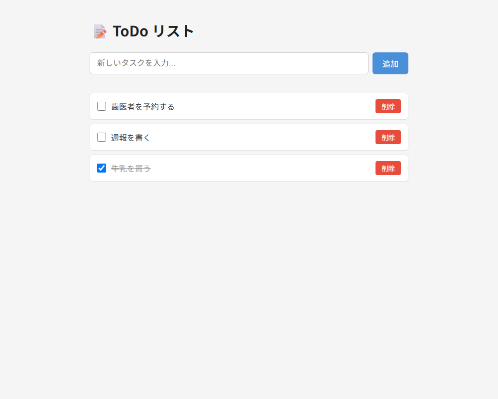

# Auto Coding Ecosystem (ACE / エース)

[🇯🇵 日本語](README.md) | [🇺🇸 English](README.en.md)

Auto Coding Ecosystem、略称 **ACE（エース）** は、Claude / Codex / GitHub CLI を使い、要件定義、設計、タスク分解、実装、レビュー、修正、PR 作成、マージまでを支援するローカル実行型の自動コーディングパイプラインです。

> 初めて触る方は、仕組みと使い方を図解した [HTML ガイド](https://noppi401.github.io/auto-coding-ecosystem/guide.html) をご覧ください。

**検証結果**: 依頼文 1 つから、空のリポジトリに ToDo Web アプリを完成させました。人の手による修正はありません。

- 8 タスクを 8 本の PR にして、すべてマージ
- テスト 200 件がすべて成功
- 所要時間は約 1 時間 28 分、費用は $8.24（Claude CLI の見積もり）

詳しくは [動作検証レポート](docs/test-runs/2026-11-todo-app.md) を参照してください。



## スクリーンショット

### ホームメニュー（`npm run dev`）

```text
 ▲  Auto Coding Ecosystem

 ◆  何をしますか？
 │  ● New request              新しい依頼を作成
 │  ○ Run from Issue           既存リポジトリの open Issue を選んで実行
 │  ○ Resume Phase 2  (myorg/my-app)  未完了のコーディングループに復帰
 │  ○ Phase 1 only             計画のみ実行（Issue起票して停止）
 │  ○ Show status              現在のプロジェクト状態を表示
 │  ○ Quit
 └
```

### 依頼ウィザード（New request）

```text
 ◆  プロジェクトの種類
 │  ● 新規リポジトリを作成する    新しいリポジトリを作成して実装
 │  ○ 既存リポジトリを改修する    既存のリポジトリに機能追加・修正
 └

 ◆  新規リポジトリ名
 │  my-new-app
 └

 ◆  依頼文の入力方法
 │  ● 1行で入力              短い指示向け
 │  ○ エディタで複数行入力    $EDITOR / notepad を開いて改行込みで入力
 │  ○ ファイルを指定          .md / .txt / .html（PDF は非対応）
 └

 ◆  どのフェーズを実行しますか？
 │  ● Phase 1 + 2  (計画→実装まで自動)  推奨
 │  ○ Phase 1 only  (計画のみ・Issue起票)
 │  ○ Phase 2 only  (既存の計画から再開)
 └

 ◆  実行AI（第1候補）
 │  ● Claude   Anthropic Claude CLI
 │  ○ Codex    OpenAI Codex CLI
 │  ○ Gemini   Google Gemini CLI
 └

 ◇  準備完了 · myorg/my-new-app · phase1+2 · claude→codex
```

### 実行画面（Phase 2 コーディングループ）

```text
▲ Auto Coding Ecosystem · myorg/my-app · Phase 2 · Coding Loop · ⣷ 実行中 · 00:03:42
────────────────────────────────────────────────────────────────────────────────────────
 #1 ✓ プロジェクトのセットアップ          │ Task 4/6 · Issue #7 · タスク一覧コマンドの実装
 #2 ✓ データ永続化層の実装                │ ────────────────────────────────────────────
 #3 ✓ タスク追加コマンドの実装            │ [info]  CodingAgent: generating code...
 #4 ⣷ タスク一覧コマンドの実装            │ [info]  Running tsc --noEmit...
 #5 ○ タスク完了・削除コマンドの実装      │ [info]  Running npm test...
 #6 ○ E2E テストとドキュメント            │ [info]  ReviewAgent: checking diff...
                                           │ [info]  No blocking issues found.
                                           │ [info]  GitHubAgent: merging PR #8...
────────────────────────────────────────────────────────────────────────────────────────
  ↑↓ フォーカス  Enter 展開  l ログ  o PR を開く  q 終了
```

### タスク承認プレビュー（Issue 起票前）

```text
▲ Auto Coding Ecosystem · myorg/my-app · Phase 1 · Task Decomp · ⏸ 入力待ち · 00:01:12
────────────────────────────────────────────────────────────────────────────────────────
 ▶ タスク分解結果（6件）· Issue 起票前の確認
   1. プロジェクトのセットアップ [low]
   2. データ永続化層の実装 [medium]
   3. タスク追加コマンドの実装 [low]
   4. タスク一覧コマンドの実装 [low]
   5. タスク完了・削除コマンドの実装 [medium]
   6. E2E テストとドキュメント [medium]
   Enter で承認して Issue 起票 · c で中止
────────────────────────────────────────────────────────────────────────────────────────
```

### セッション完了画面（SummaryScreen）

```text
▲ Session complete · myorg/my-app · duration 00:18:45
────────────────────────────────────────────────────────────────────────────────────────
    6 merged      0 failed      0 skipped      0 pending
  ██████████████████████████████████████████  100%

──────────────────────────────────────────────────────────────────────────────────────
 #  TASK                               STATUS        PR     ISSUE   ITER  CHECK
 1  プロジェクトのセットアップ          ✓ merged      #2     #1      -     -
 2  データ永続化層の実装                ✓ merged      #4     #3      -     -
 3  タスク追加コマンドの実装            ✓ merged      #6     #5      -     -
 4  タスク一覧コマンドの実装            ✓ merged      #8     #7      2/5   -
 5  タスク完了・削除コマンドの実装      ✓ merged      #10    #9      -     -
 6  E2E テストとドキュメント            ✓ merged      #12    #11     -     -
──────────────────────────────────────────────────────────────────────────────────────
  REPOSITORY  https://github.com/myorg/my-app
  ↑↓ フォーカス  l ログ  Enter 再実行  q 終了
```

### ステータス確認（`npm run dev -- status`）

```text
Project   : myorg/my-app
Repo      : https://github.com/myorg/my-app
Phase     : coding_loop
Instruction: Node.js でタスク管理 CLI を作る。タスクの追加、一覧、完了、削除ができ...
Progress  : [████████░░░░░░░░░░░░░░░░] 33%  (2/6)
Summary   : merged 2  in-progress 1  pending 3  skipped 0  failed 0

#   TASK                                 STATUS       ISSUE   PR     AGE     DETAIL
---------------------------------------------------------------------------------------------
1   プロジェクトのセットアップ             merged       #1      #2     45m00s  -
2   データ永続化層の実装                   merged       #3      #4     32m18s  -
3   タスク追加コマンドの実装               in-progress  #5      #6     03m41s  -
4   タスク一覧コマンドの実装               pending      #7      -      0s      -
5   タスク完了・削除コマンドの実装          pending      #9      -      0s      -
6   E2E テストとドキュメント               pending      #11     -      0s      -

Links:
  1. プロジェクトのセットアップ  issue https://github.com/myorg/my-app/issues/1  pr https://github.com/myorg/my-app/pull/2
  ...
```

## 仕組み（パイプラインとエージェント構成）

オーケストレーター（`Orchestrator`）が各エージェントを順に呼び出し、状態は `.ecosystem/state.json`（`StateManager`）に保存されます。各エージェントは `BaseAgent` を継承し、LLM provider（Claude / Codex / Gemini / local）の呼び出し・フォールバック・利用上限検知を共通化しています。

### Phase 1: 計画（要件 → 設計 → タスク分解 → Issue 起票）

1. **RequirementsAgent** が指示文（と既存リポジトリのコンテキスト）から要件定義を生成。指示文が `REQ_SPLIT_CHARS`（既定 8000 文字）以上なら、md の見出し（見出しがなければ LLM が提案した行範囲）でカテゴリに分け、カテゴリごとに要件定義したうえで「カテゴリ横断の要件・矛盾点」を追記して統合する。
2. **RequirementsValidationAgent** が要件をスコア評価し、閾値未満なら修正ループ（`.ecosystem/requirements-validation.md`）。
3. **DesignAgent** が要件から設計書を生成。
4. **DesignValidationAgent** が設計をスコア評価し、閾値未満なら修正ループ（`.ecosystem/design-validation.md`）。
5. **TaskDecompAgent** が要件定義・設計書の全文から実装可能なタスクへ分解（各タスクに複雑度 `complexity` と、そのタスク専用の小さなテストファイル `testFiles` を付与）。`package.json` を作るタスクが設定ファイルだけを扱う場合は、先頭に並べ替える。
6. 分解したタスクの最後に、**受け入れタスク**（受け入れテストと起動確認）を自動で追加する（`ACCEPTANCE_TASK_ENABLED=false` で無効化）。
7. タスク一覧を承認（`TASK_APPROVAL`）後、**GitHubAgent** が各タスクの Issue を起票。

既存リポジトリ改修時は **RepoContextSummaryAgent** がリポジトリコンテキストを一度だけ要約し、上記 1・3・5 で再利用してトークンを抑えます（`REPO_CONTEXT_SUMMARY`）。

Claude はツールを無効にした `claude -p` で呼び出し、結果は JSON のテキストとしてだけ受け取ります（モデルが作業フォルダへ直接書き込んだり、外部サービスを操作したりしないため）。起動後に反応がない場合は検知して呼び直します（`CLAUDE_STARTUP_TIMEOUT_MS` / `CLAUDE_STARTUP_RETRIES`）。

### Phase 2: 実装（タスクごとのコーディングループ）

タスクを 1 件ずつ、常に「アクティブな Issue/PR は 1 つ」を保ちながら処理します。

1. **GitHubAgent** がブランチを作成。
2. **CodingAgent** がコードとテストファイルを生成（タスクの複雑度に応じて実装モデルを自動選択: `TASK_MODEL_ROUTING`）。設定ファイル（`package.json` / `tsconfig.json`）・ファイル一覧・他タスクの計画と、対象ファイルの現在の全文を見たうえで、新規ファイルは行の配列、既存ファイルは差分（hunk）で出力する。テストファイルが出力されなかった場合はリトライして確実に生成する。
   - 受け入れタスクでは、代わりに **AcceptanceTestAgent** が、実装を見ずに要件だけから HTTP レベルの受け入れテストを書く（実際にアプリを起動して確かめる）。
3. **GitHubAgent** がコミットし PR を作成、Issue に PR リンクをコメント。
4. レビューループ:
   - 決定論ゲートを worktree で実行する。実装と修正のたびに必ず通る。
     - 型チェック（`tsc --noEmit`、`tsconfig.json` がある場合）と JS の構文チェック（`node --check`）
     - 依存インストールと `npm test`。`package.json` や test script がなければ、`node --test` でテストファイルを直接実行する
     - test script が一部のテストファイルしか実行していないことの検出
     - 受け入れタスクのみ: 起動確認（`npm start` で PORT を渡して起動し、`GET /` が 2xx/3xx を返すか）と、起動ファイルからどこにも読み込まれていないソースファイルの検出
     - テスト失敗時は、失敗ファイル・テスト名・エラーを構造化して **FixAgent** へ渡す
   - PR diff から、テストファイルの削除・`.skip` 追加・テストケースやアサーションの純減を自動検出し、blocking としてブロック（**FixAgent** によるテスト消去を防止）。
   - **ReviewAgent**（＋任意で **CodexAgent** の独立レビュー: `CODEX_REVIEW_ENABLED`）が PR diff を評価。変更ファイルの全文・設定ファイル・変更ファイルが読み込むリポジトリ内のファイルも渡し、呼び出し先との食い違いも確認する。
   - blocking 指摘があれば **FixAgent** が修正コミット → 再レビュー（最大 `MAX_REVIEW_ITERATIONS` 回）。FixAgent が見ていない既存ファイルを上書きしようとした場合はガードで止め、そのファイルを見せて 1 回だけ呼び直す。
5. 承認されたら **GitHubAgent** がマージ → Issue クローズ → 確認用 worktree を同期。

実際に ToDo アプリを生成させた検証の記録（実行時間・費用・スクリーンショット）は [`docs/test-runs/2026-11-todo-app.md`](docs/test-runs/2026-11-todo-app.md) にあります。

レビュー時の PR diff は `PR_DIFF_MAX_CHARS` で上限・トリミングされ、コード生成へ渡す要件/設計書は `IMPL_DOC_RELEVANCE` でタスク関連部分に絞り込めます（いずれもトークン削減）。

利用上限（usage limit）に達すると `FALLBACK_LLM_PROVIDER` へ自動切替、または `--retry-failed` で再開できます。

### 状態と UI

- 状態は `.ecosystem/state.json` に逐次保存され、`Orchestrator` ↔ Ink UI 間はイベントバス（`src/events.ts`）で連携します。
- 対話 UI のヘッダーは実行状態（⏸ 入力待ち / ● 実行中 / ✓ 完了）を常時表示し、ログ表示中も現在処理中の Issue/タスクが分かります。

## 前提条件

- Node.js 20 以上
- Claude CLI（`claude` コマンドが使えること）
- GitHub CLI（`gh auth login` 済み）
- Codex CLI（Claude の usage limit 時のフォールバックに使用）
- GitHub のアクセストークン

## セットアップ

```bash
npm install
cp .env.example .env
```

`.env` には最低限、次を設定します。

```env
GITHUB_TOKEN=ghp_xxx
GITHUB_OWNER=your-github-owner
```

## 起動

対話モードで起動します。

```bash
npm run dev
```

Windows Terminal の別ウィンドウで起動する場合:

```powershell
npm run dev:window
```

## グローバルコマンドとして使う（`ace`）

ビルドして `npm link` すると、どのディレクトリからでも `ace` で起動できます。

```bash
npm run build
npm link
```

```bash
ace                       # 対話モード（ホームメニュー）
ace status                # 状態確認
ace phase2 --retry-failed # 失敗タスクを再試行
ace start --instruction-file ./instruction.txt --repo-name my-repo --auto
```

`ace <command>` は `npm run dev -- <command>` と同じ引数を受け付けます。リンクを解除する場合は `npm unlink -g auto-coding-ecosystem` を実行します。

> 補足: `ace` は実行したディレクトリの `.ecosystem/state.json` を参照します。プロジェクトごとに作業ディレクトリを分けて実行してください。

## 基本コマンド

### 新規リポジトリを作る

```bash
npm run dev -- start --instruction-file ./instruction.txt --repo-name my-repo
```

Phase 1 から Phase 2 まで自動実行する場合:

```bash
npm run dev -- start --instruction-file ./instruction.txt --repo-name my-repo --auto
```

### 既存リポジトリを改修する

```bash
npm run dev -- modify --target-repo owner/repo --instruction-file ./change-request.txt --auto
```

`.env` の `GITHUB_OWNER` 配下のリポジトリなら、repo 名だけでも指定できます。

```bash
npm run dev -- modify --target-repo existing-app --instruction-file ./change-request.txt --auto
```

対話モードの `Run from Issue` では、open Issue の一覧から複数選択または全件選択で実行対象を選べます。既存 Issue を選んだ場合は追加のタスク分解 Issue を作らず、各 Issue 自体を実行タスクとして扱います。CLI で Issue を直接指定する場合:

```bash
npm run dev -- modify --target-repo owner/repo --issue-number 123 --auto
npm run dev -- modify --target-repo owner/repo --issue-number 123,124 --auto
```

### Phase 2 だけ実行する

```bash
npm run dev -- phase2
```

失敗タスクを再試行する場合:

```bash
npm run dev -- phase2 --retry-failed
```

Claude / Codex の利用上限に達するまで失敗タスクを再試行する場合:

```bash
npm run dev -- phase2 --retry-failed --loop-until-limit --limit-provider all
```

### 状態を確認する

```bash
npm run dev -- status
```

状態は `.ecosystem/state.json` に保存されます。

## 対話モードの便利機能

- **依頼文の複数行入力**: 新規依頼で「エディタで複数行入力」を選ぶと `$EDITOR`（なければ Windows: notepad / 他: vi）が開き、改行込みの長い指示を入力できます。
- **依頼文のファイル指定**: 「ファイルを指定」を選ぶと、`.md` / `.txt` / `.html` の要件ファイルを読み込めます。HTML はタグ・script・style を除いたテキストに変換されます。PDF は非対応です（読み込もうとするとエラーになります）。
- **選択値の保存・復元**: プロバイダー・モデル・フェーズ等の選択は `.ecosystem/wizard-defaults.json` に保存され、次回起動時に初期選択として復元されます（`.env` / CLI 引数が優先）。
- **処理回数の選択**: `Phase 1 + 2` 実行時に「1回 / 複数回 / リミットまで」を選べます（新規依頼・Issue 実行の両方）。
- **タスク承認**: Issue 起票前にタスク一覧をプレビューし、承認（Enter）/ 中止（c）を選べます（`TASK_APPROVAL=false` で無効化、`--auto` 時はスキップ）。
- **モデル自動選択**: Claude を選択した場合、実装モデル選択後に「固定 / 自動」を選べます。「自動」にするとタスクの複雑度（low/medium/high）に応じて haiku/sonnet/opus を自動選択します（選んだ実装モデルが上限）。
- **実行状態の可視化**: ヘッダーに ⏸ 入力待ち / ● 実行中 / ✓ 完了 を常時表示。ログ表示中も現在処理中の Issue が分かります。

## 指示ファイルの作り方

長い日本語指示は、文字化けやシェル解釈の事故を避けるため `--instruction-file` で渡すことを推奨します。ファイルは `.md` / `.txt` / `.html` に対応しています（HTML はテキストに変換、PDF は非対応）。

PowerShell:

```powershell
@'
Node.js でタスク管理 CLI を作る。タスクの追加、一覧、完了、削除ができ、JSON ファイルに保存する。
'@ | Out-File -Encoding utf8 instruction.txt

npm run dev -- start --instruction-file ./instruction.txt --repo-name task-cli-test --auto
```

bash / WSL:

```bash
cat > instruction.txt <<'EOF'
Node.js でタスク管理 CLI を作る。タスクの追加、一覧、完了、削除ができ、JSON ファイルに保存する。
EOF

npm run dev -- start --instruction-file ./instruction.txt --repo-name task-cli-test --auto
```

## モデル指定

CLI 引数でモデルを指定できます。CLI 引数は `.env` より優先されます。

```bash
npm run dev -- start --instruction-file ./instruction.txt --repo-name my-repo --claude-model claude-opus-4-7
```

```bash
npm run dev -- phase2 --planning-model claude-haiku-4-5-20251001
```

```bash
npm run dev -- phase2 --impl-model claude-sonnet-4-6
```

Codex を指定する場合は、モデルとインテリジェンスを同時に指定できます。

```bash
npm run dev -- start --instruction-file ./instruction.txt --repo-name my-repo --provider codex --codex-model gpt-5.5 --codex-intelligence high
```

| オプション | 対応する環境変数 | 説明 |
| --- | --- | --- |
| `--provider <claude\|codex\|gemini>` | `PLANNING_LLM_PROVIDER` / `IMPLEMENTATION_LLM_PROVIDER` | planning と implementation の provider を一括変更 |
| `--fallback-provider <claude\|codex\|gemini>` | `FALLBACK_LLM_PROVIDER` | primary provider の上限時に使う provider |
| `--claude-model <id>` | `PLANNING_CLAUDE_MODEL` / `IMPLEMENTATION_CLAUDE_MODEL` | planning と implementation の両方を一括変更 |
| `--planning-model <id>` | `PLANNING_CLAUDE_MODEL` | 要件、設計、タスク分解側のモデル |
| `--impl-model <id>` | `IMPLEMENTATION_CLAUDE_MODEL` | CodingAgent / FixAgent 側のモデル |
| `--codex-model <id>` | `CODEX_MODEL` | Codex CLI に渡すモデル |
| `--gemini-model <id>` | `PLANNING_GEMINI_MODEL` / `IMPLEMENTATION_GEMINI_MODEL` | Gemini CLI に渡すモデル（planning と implementation の両方を一括設定） |
| `--codex-intelligence <low\|medium\|high\|xhigh>` | `CODEX_INTELLIGENCE` | Codex CLI の `model_reasoning_effort` |

### タスク複雑度に応じたモデル自動選択（トークン削減）

`TASK_MODEL_ROUTING=true` を設定するか、対話モードのウィザードで「自動」を選ぶと、TaskDecompAgent が各タスクに付与した複雑度（low / medium / high）に応じて実装モデルを自動選択します（既定: low→haiku, medium→sonnet, high→opus）。単純なタスクを安価なモデルに振り分けることでトークン/コストを削減します。

ユーザーが `--impl-model` や Wizard で実装モデルを明示した場合は、その選択を「上限」として扱い、ルーティング結果がそれより高コストになることはありません（例: sonnet を選ぶと high タスクも sonnet 止まり、low タスクは haiku のまま）。`TASK_MODEL_LOW` / `TASK_MODEL_MEDIUM` / `TASK_MODEL_HIGH` で各ランクのモデルを上書きできます。

## 主な環境変数

| 変数 | 既定値 | 説明 |
| --- | --- | --- |
| `GITHUB_TOKEN` | なし | GitHub API / CLI 用トークン |
| `GITHUB_OWNER` | なし | 既定の GitHub owner |
| `BASE_BRANCH` | `main` | PR のベースブランチ |
| `MAX_REVIEW_ITERATIONS` | `5` | レビューと修正の最大反復回数 |
| `TASK_APPROVAL` | `true` | 対話実行時、タスク分解結果を GitHub Issue 起票前にプレビュー・承認する。`false` で無効化（`--auto` 時は常にスキップ） |
| `ACCEPTANCE_TASK_ENABLED` | `true` | タスク分解の最後に受け入れタスク（受け入れテストと起動確認）を自動追加する。`false` で無効化 |
| `PLANNING_LLM_PROVIDER` | `claude` | Phase 1 系の LLM provider |
| `IMPLEMENTATION_LLM_PROVIDER` | `claude` | 実装、修正系の LLM provider |
| `CLAUDE_MODEL` | `claude-haiku-4-5-20251001` | Claude CLI の共通モデル |
| `IMPLEMENTATION_CLAUDE_MODEL` | `claude-sonnet-4-6` | CodingAgent / FixAgent 専用モデル |
| `TASK_MODEL_ROUTING` | `false` | タスクの複雑度に応じて実装モデルを自動選択する（トークン削減）。`true` で有効化（対話モードのウィザードでも設定可） |
| `TASK_MODEL_LOW` | `claude-haiku-4-5-20251001` | complexity=low のタスクに使う実装モデル |
| `TASK_MODEL_MEDIUM` | `claude-sonnet-4-6` | complexity=medium のタスクに使う実装モデル |
| `TASK_MODEL_HIGH` | `claude-opus-4-7` | complexity=high のタスクに使う実装モデル |
| `IMPL_DOC_RELEVANCE` | `false` | コード生成時に要件・設計書をタスク関連部分へ絞り込む（トークン削減）。`true` で有効化 |
| `IMPL_DOC_MAX_CHARS` | `6000` | 絞り込み時に CodingAgent へ渡す要件定義の最大文字数 |
| `IMPL_DESIGN_DOC_MAX_CHARS` | `4000` | 絞り込み時に CodingAgent へ渡す設計書の最大文字数 |
| `CODING_DOC_MAX_CHARS` | `40000` | CodingAgent へ渡す要件定義・設計書の最大文字数（それぞれ）。超えた分は警告を出して切る |
| `REVIEW_DOC_MAX_CHARS` | `40000` | ReviewAgent へ渡す要件定義・設計書の最大文字数（それぞれ）。超えた分は警告を出して切る |
| `PR_DIFF_MAX_CHARS` | `30000` | レビュー/修正に渡す PR diff の最大文字数。超過時はトリミング。`0` で無効化 |
| `PR_DIFF_EXCLUDE` | `package-lock.json,pnpm-lock.yaml,yarn.lock` | PR diff から除外するファイル名（カンマ区切り） |
| `GEMINI_API_KEY` | なし | Gemini API キー |
| `GEMINI_MODEL` | `gemini-2.5-flash` | Gemini の共通モデル（planning / implementation 両方の既定） |
| `PLANNING_GEMINI_MODEL` | `GEMINI_MODEL` | planning 系で使う Gemini モデル |
| `IMPLEMENTATION_GEMINI_MODEL` | `GEMINI_MODEL` | implementation 系で使う Gemini モデル |
| `BUILD_CHECK_ENABLED` | `true` | PR 後のビルド/型チェック/テスト実行を有効化するか |
| `COVERAGE_CHECK_ENABLED` | `false` | カバレッジ計測を有効化（`true` で有効化）。`package.json` に `test:coverage` スクリプトが必要 |
| `COVERAGE_LINE_THRESHOLD` | `70` | ラインカバレッジ閾値（%）。未満なら suggestion コメント |
| `COVERAGE_BRANCH_THRESHOLD` | `60` | 分岐カバレッジ閾値（%）。未満なら suggestion コメント |
| `COVERAGE_CHECK_STRICT` | `false` | `true` の場合、カバレッジ未計測・未解析・実行失敗を blocking として扱う |
| `CODEX_REVIEW_ENABLED` | `false` | Codex 独立レビューを有効化するか |
| `CODEX_MODEL` | Codex CLI の既定値 | Codex CLI に渡すモデル |
| `CODEX_INTELLIGENCE` | Codex CLI の既定値 | Codex CLI の `model_reasoning_effort` (`low` / `medium` / `high` / `xhigh`) |
| `CODEX_TIMEOUT_MS` | `AGENT_COMMAND_TIMEOUT_MS` | CodexAgent 専用のタイムアウト。未指定時は `AGENT_COMMAND_TIMEOUT_MS`、さらに未指定なら `900000` を使う |
| `PROJECT_RULES_FILE` | `prompts/project-rules.md` | Claude と Codex に渡すコード生成のルールのファイル。相対パスは実行ディレクトリから解決する（絶対パスも可）。以前の名前 `CODEX_PROJECT_RULES_FILE` も使える |
| `RESUME_AGENT_SESSIONS` | `false` | Claude セッション継続を使うか |
| `AGENT_COMMAND_TIMEOUT_MS` | `900000` | BaseAgent 系コマンドのタイムアウト。`CODEX_TIMEOUT_MS` 未指定時は CodexAgent もこの値を使う |
| `CLAUDE_STARTUP_TIMEOUT_MS` | `120000` | Claude CLI の起動後、最初の出力を待つ時間。超えたら呼び直す |
| `CLAUDE_STARTUP_RETRIES` | `2` | 起動後に反応がない場合に呼び直す回数 |
| `CODING_CURRENT_FILE_MAX_CHARS` | `60000` | CodingAgent に渡す既存ファイル 1 件あたりの最大文字数 |
| `FIX_CURRENT_FILE_MAX_CHARS` | `60000` | FixAgent に渡す既存ファイル 1 件あたりの最大文字数 |
| `REPO_CONTEXT_SUMMARY` | `false` | modify 時にリポジトリコンテキストを一度だけ要約し、要件/設計/タスク分解で再利用してトークンを削減する。`true` で有効化 |
| `REPO_CONTEXT_SUMMARY_INPUT_MAX_CHARS` | `40000` | 要約エージェントに渡すコンテキストの最大文字数 |
| `REQ_SPLIT_MODE` | `auto` | 要件定義のカテゴリ分割。`auto`（文字数で判断）/ `always` / `never` |
| `REQ_SPLIT_CHARS` | `8000` | `auto` 時、指示文がこの文字数以上ならカテゴリ別に要件定義する |
| `TASK_DECOMP_REQ_DOC_MAX_CHARS` | なし（全文） | タスク分解に渡す要件定義の最大文字数。指定時は超過分を切り詰め、警告ログを出す |
| `TASK_DECOMP_DESIGN_DOC_MAX_CHARS` | なし（全文） | タスク分解に渡す設計書の最大文字数。指定時は超過分を切り詰め、警告ログを出す |
| `REPO_CONTEXT_MAX_FILES` | `80` | 既存 repo 読み取り時の最大ファイル数 |
| `REPO_CONTEXT_MAX_CHARS` | `40000` | 既存 repo 読み取り時の最大文字数 |
| `REPO_CONTEXT_FILE_MAX_CHARS` | `4000` | 1 ファイルあたりの最大文字数 |
| `ISSUE_SELECT_LIMIT` | `30` | 対話モードで一覧表示する open Issue の最大件数 |
| `ISSUE_RUN_ALL_LIMIT` | `1000` | `Run from Issue` の全件実行で取得する open Issue の最大件数 |
| `PHASE2_LOOP_MAX_ATTEMPTS` | `100` | `--loop-until-limit` の最大試行回数 |
| `LOG_LEVEL` | `info` | ログレベル |
| `ACE_LANG` | `ja`（`LANG` が `en` で始まる場合は `en`） | 画面と、ACE が書く文章（PR コメント・検証レポート・Issue）の言語。`en` で英語 |

## 開発コマンド

```bash
npm run build
npx tsc --noEmit
npm test
npm run dev -- status
```

PowerShell で `npm` / `npx` が実行ポリシーに止められる場合は、`.cmd` 経由で実行します。

```powershell
npm.cmd run build
npx.cmd tsc --noEmit
```

## 生成されたアプリの確認コマンド

ecosystem が生成した worktree は `.ecosystem/worktrees/<owner>/<repo>/...` 配下に作られます。例として、実行元として使う作業ツリーは次のようになります（`<owner>` / `<repo>` は対象に置き換えてください）。

```powershell
cd .ecosystem\worktrees\<owner>\<repo>\__context
```

Phase 2 では PR マージ直後と完了直前に、この `__context` worktree を `origin/<BASE_BRANCH>` へ同期します。同期できない場合は Phase 2 を completed にせず失敗として扱います。

`__context` に未コミット変更がある場合は、安全のため自動同期を止めます。エラーには対象パス、`git status --porcelain` の変更ファイル一覧、復旧手順が表示されます。手元の変更を退避またはコミットしてから再実行してください。

また、`~/Documents/Products/<repo>` が存在する場合は、そこも確認用 checkout として同じタイミングで同期します。例えば次のようなパスが対象です。

```powershell
C:\path\to\Products\<repo>
```

確認用 checkout を明示したい場合は、`.env` などで次を設定できます。

```env
ECOSYSTEM_PRODUCT_WORKTREE=C:\path\to\Products\<repo>
```

複数リポジトリで `Products` のルートだけ変えたい場合:

```env
ECOSYSTEM_PRODUCT_ROOT=C:\path\to\Products
```

Products 側に未コミット変更がある場合も、安全のため同期を止めます。`ECOSYSTEM_PRODUCT_WORKTREE` または Products checkout の対象名と dirty ファイル一覧がエラーに含まれます。

以下は、生成アプリが backend / frontend 構成（Prisma 利用）の場合の確認手順の一例です。生成物の構成に合わせて読み替えてください。

依存関係の導入:

```powershell
cd backend
npm.cmd ci
npx.cmd prisma generate
cd ..\frontend
npm.cmd ci
```

ビルド確認:

```powershell
cd ..\backend
npm.cmd run build
cd ..\frontend
npm.cmd run build
```

DB マイグレーションの反映:

```powershell
cd ..\backend
npx.cmd prisma migrate deploy
```

`DATABASE_URL` が未設定の場合、`prisma migrate deploy` は失敗します。その場合は、生成アプリ側の `.env` に `DATABASE_URL` を設定するか、通常の起動スクリプトで環境変数が読み込まれる状態にしてから再実行してください。

生成アプリを通常起動する場合（例）:

```powershell
cd ..
npm run start:dev
```

初回セットアップを含めて起動する場合:

```powershell
npm run start:all
```

## コントリビューション

不具合の報告、要望、プルリクエストを歓迎します。[CONTRIBUTING.md](CONTRIBUTING.md) を参照してください。

## ライセンス

[Apache License 2.0](LICENSE)
