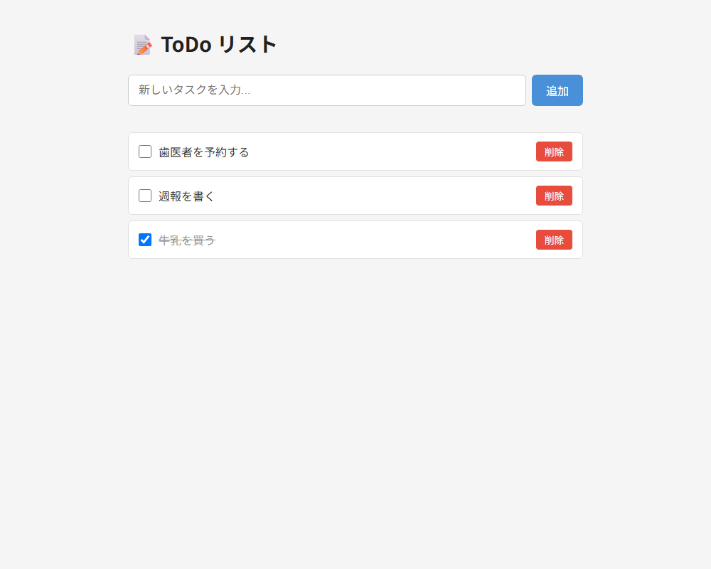

# Test Run Report: Generating a Simple ToDo Web App (November 2026)

[🇯🇵 日本語](2026-11-todo-app.md) | [🇺🇸 English](2026-11-todo-app.en.md)

This report records whether ACE can take a single request and finish a working app on GitHub.
We regenerated the app from an empty repository with the same request many times. Each time it failed, we fixed the pipeline itself. In the last run (run 35), it finished end to end with no manual changes.

## Summary (run 35)

| Item | Result |
|---|---|
| Tasks | **8 / 8 merged** (0 failed, 0 skipped) |
| Tests in the generated app | `npm test`: **all 200 pass** (including the acceptance tests) |
| Smoke check | `npm start` → `GET /` returns 200 with the page HTML |
| Run time | About 1 h 28 min (Phase 1 and Phase 2 combined; excludes waiting for the Claude usage limit to reset) |
| Cost | **$8.24** (sum of `costUsd` reported by the Claude CLI; see the note below) |
| Manual intervention | One resume command after the usage limit stopped the run (no code changes) |



*The generated app running, with three todos added through the API and one marked done (captured with headless Edge).*

## The Request

The request was written in Japanese. In English, it reads:

```text
Build a simple ToDo web app with no package dependencies. Implement the server with Node.js's
built-in http module, and serve a single HTML page where the browser can add, toggle, and delete todos.
The API is GET/POST /api/todos and PATCH/DELETE /api/todos/:id, kept in memory.
Tests use node:test to verify the API's behavior.
```

## Environment

| Item | Value |
|---|---|
| OS | Windows 11 |
| Node.js | v26.0.0 |
| Implementation agents (CodingAgent / FixAgent / AcceptanceTestAgent) | `claude-sonnet-4-6` |
| Planning agents (requirements, design, validation, decomposition, review) | `claude-haiku-4-5-20251001` |
| How the model is called | Claude Code CLI (`claude -p`, tools disabled, returns JSON only) |
| Command | `npm run dev -- --plain` (Phase 2 with `--auto` for automatic merging) |

## Phase 1: Planning

| Step | Result |
|---|---|
| Requirements → validation | 77 points (B) |
| Design → validation | 83 points (A) |
| Task decomposition | 7 tasks + 1 acceptance task added automatically = 8 tasks (GitHub Issues #1–#8) |

## Phase 2: Task by Task

Each task goes through: create a branch → implement → open a PR → review-and-fix loop (up to 3 rounds) → merge.
Each round starts with a deterministic gate (syntax check, `npm test`, a check that every test file is actually run, and so on).

| # | Task | PR | Reviews | Fixes | What happened |
|---|---|---|---|---|---|
| 1 | Project Setup & Configuration | #9 | 1 | 0 | Merged on the first round (hit the usage limit midway; finished after resuming) |
| 2 | Utility Functions Module | #10 | 1 | 0 | Merged on the first round |
| 3 | In-Memory Todo Store | #11 | 1 | 0 | Merged on the first round |
| 4 | API & HTML Handler Functions | #12 | 3 | 4 | Tests failed → fixed. One fix response could not be parsed; recovered on the next round |
| 5 | HTTP Server & Request Routing | #13 | 3 | 2 | Tests failed. **The syntax check caught a syntax error** introduced by a fix; the next fix resolved it |
| 6 | Complete Interactive HTML Frontend | #14 | 1 | 0 | Merged on the first round |
| 7 | Comprehensive Integration Test Suite | #15 | 3 | 2 | Tests failed → fixed |
| 8 | Acceptance tests and smoke check | #16 | 1 | 0 | Acceptance tests written from the requirements alone passed, and so did the smoke check (`GET /` → 200) |

## Cost Breakdown (run 35)

| Agent | Calls | Cost |
|---|---:|---:|
| CodingAgent | 11 | $4.470 |
| FixAgent | 8 | $1.595 |
| ReviewAgent | 14 | $1.020 |
| AcceptanceTestAgent | 1 | $0.832 |
| TaskDecompAgent | 1 | $0.108 |
| DesignValidationAgent | 1 | $0.083 |
| DesignAgent | 1 | $0.061 |
| RequirementsValidationAgent | 1 | $0.047 |
| RequirementsAgent | 1 | $0.024 |
| **Total** | **39** | **$8.24** |

> Note: the cost is the sum of `costUsd` that the Claude CLI reports at the end of each call (an estimate at API prices).
> This run used a subscription, so this amount was not actually billed.

## Checking the Generated App

We cloned the generated repository to a separate folder and checked it by hand.

| Check | Result |
|---|---|
| `npm test` | 200 pass, 0 fail |
| `GET /` | 200. Has an input field, add button, list, done checkboxes, and delete buttons; the page script calls `/api/todos` |
| `POST /api/todos` (valid input) | 201 |
| `POST /api/todos` (malformed JSON / empty title) | 400 / 400 |
| `GET /api/todos` | 200 (`{"todos":[...]}`) |
| `PATCH /api/todos/:id` (toggle done) | 200 |
| `DELETE /api/todos/:id` | 204 |
| `PATCH` / `DELETE` on a missing id | 404 / 404 |
| Unknown path | 404 |
| Japanese titles | Stored and displayed correctly |

Generated files: `server.js`, `handlers.js`, `store.js`, `utils.js`, `package.json`, `README.md`, and 9 files under `test/` (one test file per task, integration tests, acceptance tests, and a shared helper).

## How We Got Here

We generated the app from an empty repository about 35 times with this request. Representative runs:

| Run | Result | Time / cost | Remaining problem |
|---|---|---|---|
| runs 27–29 | A working app (178 tests) | about 1 h 36 min / $8.81 | We fixed the pipeline code while the run continued, so it does not count as a single run |
| run 34 | 9 / 9 merged in one run (184 tests; the API worked) | 1 h 13 min / $6.18 | The page was still an empty placeholder, and neither the tests nor the review caught it |
| **run 35** | **8 / 8 merged in one run; both the page and the API work** | about 1 h 28 min / $8.24 | See "Remaining Issues" below |

### Main Bugs Found and Fixed

**Calling Claude**
- The process did not exit after finishing, so the pipeline kept waiting → treat the result event as completion; detect a silent start and call again.
- The model used tools to write files directly into this repository and ran long tool sessions → disable tools for pipeline calls.
- Without tools, the model computed base64 by hand and the output ballooned (about $2 per call) → output files as arrays of lines, and edit existing files with diffs (hunks).
- Responses containing strings like "429" were mistaken for usage limits → only check the result body. Also added the limit message `You've hit your limit`.
- JSON could not be extracted when the explanation before it contained `{ }` or a ```` ```js ```` code block → extract from the ```` ```json ```` block. The validation agents retry once if the JSON cannot be read (the ```` ```js ```` case was fixed after run 35).

**Implementing and fixing**
- FixAgent overwrote existing files it had not been shown, deleting tests → a guard blocks it, then retries once with those files shown.
- CodingAgent rewrote existing code and tests without seeing them → pass the full target files and the plan for the other tasks.
- The request asked for JavaScript, but the prompt pulled the model toward TypeScript and Jest → language and test framework now follow the requirements, design, and existing project.
- The model added ESM tests to a CommonJS project, then changed `"type"` in `package.json` to match → pass the config files and file list, and forbid changing project-wide settings for one file.
- Fixes introduced syntax errors → run `node --check` after every implementation and fix.
- `server.js` and `ui/html.js` disagreed on a function's contract, so `GET /` never responded → give review and fix the files that each changed file imports.

**Tests and gates**
- `npm test` ran only some test files, so broken tests slipped through → the gate detects test files that are never run.
- The task that created `package.json` came last, so no tests ran before it → move the setup task first; run tests with `node --test` directly when there is no `package.json`.
- All tasks shared one test file, causing constant rewrites → each task owns its own small test file.
- Unit tests passed, but `GET /` returned 403 on Windows → automatically add an acceptance task at the end. It writes acceptance tests from the requirements alone and runs them over HTTP against the real app; a smoke-check gate was added too.
- A placeholder page still passed → acceptance tests must check the page's UI elements; the gate also detects source files that the entry file never loads.
- Returning 500 for malformed JSON still passed → client input errors must get 4xx.

**Review**
- Definitions outside the diff were reported as "undefined" → pass the full content of changed files.
- Files that later tasks will create were reported as "missing" → pass the plan for the other tasks.
- Added a minimal-change perspective to the review (based on [Ponytail](https://github.com/DietrichGebert/ponytail); suggestions only).

## Remaining Issues

- **Design document is truncated**: the design document (about 18.5k characters) is cut to 4,000 characters for CodingAgent and 3,000 for ReviewAgent. Setting `IMPL_DOC_RELEVANCE=true` sends only the sections relevant to the task, but it was not used in this run.
- **Coverage is not measured**: the coverage check only runs with `COVERAGE_CHECK_ENABLED=true`, which was not enabled in this run.
- **Review approval**: GitHub does not allow approving your own PR, so the approval is left as a comment.
- **Usage limits**: long runs can hit Claude's usage limit. Phase 2 then stops where it is and can be resumed with `npm run dev -- phase2 --retry-failed`.
