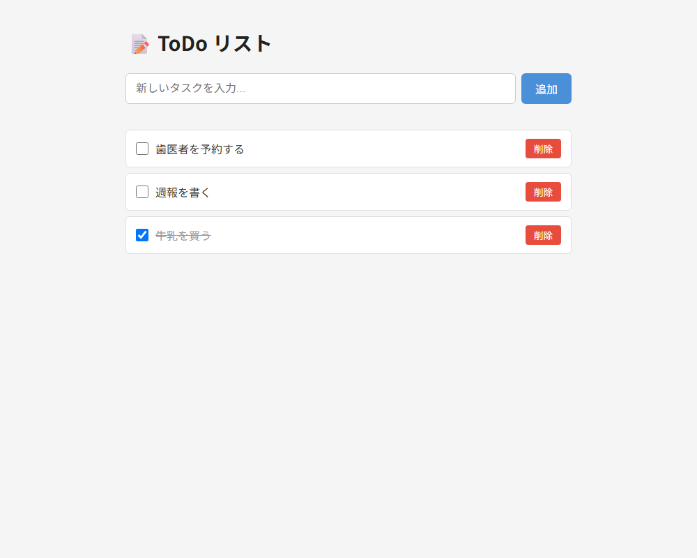

# 動作検証レポート: 簡易 ToDo Web アプリの自動生成（2026年11月）

ACE が「依頼文 1 つから、動くアプリを GitHub 上に完成させられるか」を確かめた記録です。
同じ依頼文で、空のリポジトリからの生成を何度もやり直しました。失敗するたびにパイプライン側の不具合を直し、最後の実行（run 35）で、人の手を入れずに最後まで完成しました。

## 結果の要約（run 35）

| 項目 | 結果 |
|---|---|
| タスク | **8 / 8 マージ**（失敗 0・スキップ 0） |
| 生成物のテスト | `npm test` **200 件すべて成功**（受け入れテストを含む） |
| 起動確認 | `npm start` → `GET /` が 200 で、画面の HTML を返す |
| 実行時間 | 約 1 時間 28 分（Phase 1 と Phase 2 の合計。Claude の利用上限によるリセット待ちの時間は含まない） |
| 費用 | **$8.24**（Claude CLI が報告する `costUsd` の合計。下の注を参照） |
| 人の介入 | 利用上限で止まった後の再開コマンド 1 回だけ（コードの手直しはなし） |



*生成されたアプリを起動し、API から 3 件を登録して 1 件を完了にした状態です（Edge ヘッドレスで撮影）。*

## 入力した依頼文

```text
依存パッケージなしの簡易ToDo Webアプリを作る。Node.js標準のhttpモジュールでサーバーを実装し、
ブラウザから ToDo の追加・完了切替・削除ができる単一HTMLページを配信する。
APIは GET/POST /api/todos, PATCH/DELETE /api/todos/:id でメモリ上に保持する。
テストは node:test でAPIの振る舞いを検証する。
```

## 実行環境

| 項目 | 値 |
|---|---|
| OS | Windows 11 |
| Node.js | v26.0.0 |
| 実装系エージェント（CodingAgent / FixAgent / AcceptanceTestAgent） | `claude-sonnet-4-6` |
| 計画系エージェント（要件・設計・検証・分解・レビュー） | `claude-haiku-4-5-20251001` |
| 呼び出し方法 | Claude Code CLI（`claude -p`、ツール無効、JSON だけを返させる） |
| 起動コマンド | `npm run dev -- --plain`（Phase 2 は `--auto` で自動マージ） |

## Phase 1: 計画

| 工程 | 結果 |
|---|---|
| 要件定義 → 妥当性検証 | 77 点（B） |
| 設計 → 妥当性検証 | 83 点（A） |
| タスク分解 | 7 タスク ＋ 受け入れタスク 1 件を自動追加 = 8 タスク（GitHub Issue #1〜#8） |

## Phase 2: タスクごとの経過

1 タスクにつき、ブランチ作成 → 実装 → PR → レビューと修正の繰り返し（最大 3 回）→ マージ、の順に進みます。
各回の最初に、決定論的なゲート（構文チェック、`npm test`、テストが実行されているかの確認など）を通します。

| # | タスク | PR | レビュー回数 | 修正回数 | 経過 |
|---|---|---|---|---|---|
| 1 | Project Setup & Configuration | #9 | 1 | 0 | 1 回目でマージ（途中で利用上限に達し、再開後に完了） |
| 2 | Utility Functions Module | #10 | 1 | 0 | 1 回目でマージ |
| 3 | In-Memory Todo Store | #11 | 1 | 0 | 1 回目でマージ |
| 4 | API & HTML Handler Functions | #12 | 3 | 4 | テスト失敗 → 修正。修正の出力を 1 回読めなかったが、次の回で回復 |
| 5 | HTTP Server & Request Routing | #13 | 3 | 2 | テスト失敗。修正で入った**構文エラーを構文チェックが検出**し、次の修正で解消 |
| 6 | Complete Interactive HTML Frontend | #14 | 1 | 0 | 1 回目でマージ |
| 7 | Comprehensive Integration Test Suite | #15 | 3 | 2 | テスト失敗 → 修正 |
| 8 | 受け入れテストと起動確認 | #16 | 1 | 0 | 要件だけから書いた受け入れテストが成功し、起動確認（`GET /` → 200）も通過 |

## 費用の内訳（run 35）

| エージェント | 呼び出し回数 | 費用 |
|---|---:|---:|
| CodingAgent | 11 | $4.470 |
| FixAgent | 8 | $1.595 |
| ReviewAgent | 14 | $1.020 |
| AcceptanceTestAgent | 1 | $0.832 |
| TaskDecompAgent | 1 | $0.108 |
| DesignValidationAgent | 1 | $0.083 |
| DesignAgent | 1 | $0.061 |
| RequirementsValidationAgent | 1 | $0.047 |
| RequirementsAgent | 1 | $0.024 |
| **合計** | **39** | **$8.24** |

> 注: 費用は Claude CLI が各呼び出しの終わりに報告する `costUsd`（API 料金に換算した見積もり）を合計したものです。
> 今回はサブスクリプションの範囲内で実行しているため、この金額がそのまま請求されたわけではありません。

## 生成物の動作確認

生成されたリポジトリを別の場所に複製し、手で確かめました。

| 確認内容 | 結果 |
|---|---|
| `npm test` | 200 件成功・失敗 0 |
| `GET /` | 200。入力欄・追加ボタン・一覧・完了チェック・削除ボタンがあり、画面のスクリプトから `/api/todos` を呼ぶ |
| `POST /api/todos`（正しい入力） | 201 |
| `POST /api/todos`（壊れた JSON / 空のタイトル） | 400 / 400 |
| `GET /api/todos` | 200（`{"todos":[...]}`） |
| `PATCH /api/todos/:id`（完了の切り替え） | 200 |
| `DELETE /api/todos/:id` | 204 |
| 存在しない ID への `PATCH` / `DELETE` | 404 / 404 |
| 存在しないパス | 404 |
| 日本語のタイトル | 正しく保存・表示される |

生成されたファイル: `server.js`、`handlers.js`、`store.js`、`utils.js`、`package.json`、`README.md`、`test/` 配下のテスト 9 本（タスクごとのテスト、結合テスト、受け入れテスト、共通ヘルパー）。

## ここに至るまでの経緯

この依頼文で、空のリポジトリからの生成を 35 回ほど繰り返しました。代表的な実行は次のとおりです。

| 実行 | 結果 | 時間 / 費用 | 残っていた問題 |
|---|---|---|---|
| run 27〜29 | 動くアプリが完成（テスト 178 件） | 約 1 時間 36 分 / $8.81 | 途中でパイプラインのコードを直しながら続けたため、1 回の実行とは言えない |
| run 34 | 1 回の実行で 9 / 9 マージ（テスト 184 件、API は正常） | 1 時間 13 分 / $6.18 | 画面が中身のない仮ページのまま。テストもレビューもそれを見逃した |
| **run 35** | **1 回の実行で 8 / 8 マージ。画面も API も動作** | 約 1 時間 28 分 / $8.24 | 下の「残っている課題」を参照 |

### 見つかって直した主な不具合

**Claude の呼び出し**
- 生成が終わってもプロセスが終了せず、パイプラインが止まったまま待ち続ける → 結果のイベントを受け取ったら完了とする。起動直後に反応がなければ検知して、呼び直す。
- モデルがツールを使って、このリポジトリに直接ファイルを書く・長いツール操作を続ける → パイプラインからの呼び出しではツールを無効にした。
- ツールなしではモデルが base64 を手で計算し、出力が膨れ上がる（1 回で約 $2）→ 出力を行の配列にした。既存ファイルは差分（hunk）で直させる。
- 応答の本文に「429」などが含まれると、利用上限と誤って判定する → 判定の対象を結果の本文だけにした。利用上限の文言 `You've hit your limit` も追加した。
- JSON の前の説明文に `{ }` があると、JSON を取り出せない → ```` ```json ```` ブロックから取り出す。検証エージェントでは、読めなければ 1 回だけ呼び直す。

**実装と修正**
- FixAgent が、見せていない既存ファイルを上書きし、テストが消える → ガードで止める。止めたファイルを見せて 1 回だけ呼び直す。
- CodingAgent が既存の実装やテストを見ないまま書き直す → 対象ファイルの全文と、他のタスクの計画を渡す。
- 依頼が JavaScript なのに、プロンプトに引きずられて TypeScript と Jest で書く → 言語やテスト方式は、要件・設計・既存プロジェクトに従わせる。
- CommonJS のプロジェクトに ESM のテストを足し、それに合わせて `package.json` の `"type"` を書き換える → 設定ファイルとファイル一覧を渡す。1 ファイルのために全体の設定を変えないよう指示する。
- 修正で構文エラーが入る → 実装と修正のたびに `node --check` を必ず通す。
- `server.js` と `ui/html.js` の間で関数の約束がずれ、`GET /` が応答を返さない → レビューと修正に、変更ファイルが読み込むファイルも渡す。

**テストとゲート**
- `npm test` が一部のテストファイルしか実行せず、壊れたテストが見逃される → 実行されていないテストファイルをゲートで検知する。
- `package.json` を作るタスクが最後になり、それまでテストが一度も実行されない → 設定のタスクを先頭に置く。`package.json` がなくても `node --test` で直接実行する。
- 1 本のテストファイルを全タスクで共有し、毎回書き換えが起きる → タスクごとに専用の小さなテストファイルを持たせる。
- 単体テストは通るのに、Windows では `GET /` が 403 を返す → 受け入れタスクを最後に自動で追加する。要件だけから書いた受け入れテストを、実際に起動したアプリに HTTP で流す。起動確認のゲートも加えた。
- 画面が仮ページでも合格してしまう → 受け入れテストで画面の要素を確かめさせる。起動ファイルからどこにも読み込まれていないソースファイルも検知する。
- 壊れた JSON に 500 を返しても合格してしまう → 利用者の入力の誤りには 4xx を求める。

**レビュー**
- 差分の外にある定義を「未定義」と誤って指摘する → 変更ファイルの全文を渡す。
- 後のタスクで作るファイルを「足りない」と誤って指摘する → 他のタスクの計画を渡す。
- レビューの観点に、最小変更の観点を追加（[Ponytail](https://github.com/DietrichGebert/ponytail) を参考。提案のみ）。

## 残っている課題

- **FixAgent の出力を読めないことがある**: JSON の前に ```` ```js ```` などで始まるコードブロックが付くと、読めずに失敗します（run 35 のタスク 4 で 1 回。次の回で回復）。
- **設計書が途中で切れる**: 設計書（約 18.5k 文字）は、CodingAgent に 4000 文字、ReviewAgent に 3000 文字までしか渡りません。`IMPL_DOC_RELEVANCE=true` にすると、タスクに関係する節だけを渡せますが、今回は使っていません。
- **カバレッジを測っていない**: カバレッジの確認は `COVERAGE_CHECK_ENABLED=true` のときだけ動きます。今回は有効にしていません。
- **レビューの承認**: 自分が作った PR は GitHub の仕様で正式に承認できないため、承認の内容をコメントとして残しています。
- **利用上限**: 長い実行では Claude の利用上限に達することがあります。達すると Phase 2 はその場で止まり、`npm run dev -- phase2 --retry-failed` で続きから再開できます。
